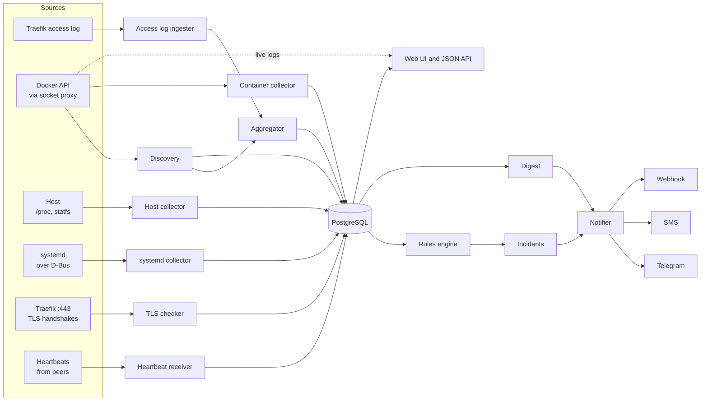

# Architecture

Raedar is one Go binary running in one container. All components live in the same process and share one PostgreSQL connection pool.

## Components

| Component | Responsibility |
|---|---|
| Discovery | Builds the model of apps, slots, containers, routes and domains from the Docker API. Records deploys and container lifecycle events. See [discovery.md](discovery.md). |
| Access log ingester | Follows the Traefik JSON access log, from a file or from the Traefik container's output, and turns each line into a measurement for a route and a normalized path. |
| Aggregator | Keeps open per-minute buckets in memory and writes them to PostgreSQL as additive upserts. |
| Container collector | Samples CPU, memory and network for every running container. |
| Host collector | Samples CPU, load, memory, swap and filesystem usage of the host, plus Docker's own disk usage. |
| systemd collector | Reads unit and timer state from systemd over D-Bus. |
| TLS checker | Performs a TLS handshake with Traefik for every routed domain and records what certificate is served. |
| Heartbeat receiver | Accepts heartbeats from other Raedar instances listed as peers. |
| Rules engine | Evaluates the rules in [alerts.md](alerts.md) once a minute, opens and resolves incidents. |
| Notifier | Delivers incident and digest messages to Telegram, SMS and webhooks, with grouping, retries and rate limits. See [notifications.md](notifications.md). |
| Digest | Composes the daily summary. |
| Heartbeat sender | Pings an external URL once a minute while Raedar is healthy. |
| Web | Server-rendered pages, a small JSON API for charts, and live container logs. See [ui.md](ui.md). |
| Store | Schema migrations, writes, hourly rollups, baselines and retention. See [storage.md](storage.md). |

## Schedule

| Task | Cadence |
|---|---|
| Docker event stream | continuous |
| Discovery full resync | every 5 minutes, and immediately on container events |
| Access log ingestion | continuous; buckets flushed every minute |
| Container stats | every 60 seconds |
| Host stats | every 60 seconds |
| Docker disk usage | every 15 minutes |
| systemd units | every 60 seconds |
| TLS checks | every 6 hours per domain (with jitter), and right after a new domain appears |
| Rule evaluation | every 60 seconds, 15 seconds after the minute flush |
| Hourly rollup | every hour at :05, recomputing the last 3 hours |
| Baselines | after each hourly rollup |
| Retention cleanup | once a day |
| Digest | once a day at `RAEDAR_DIGEST_AT` |
| Heartbeat sender | every `RAEDAR_HEARTBEAT_INTERVAL` (60 seconds by default) |

## The minute pipeline

1. The ingester reads access log lines as Traefik writes them.
2. Each line is added to an in-memory bucket for its route and minute, and to a bucket for its route, 10-minute window, method and normalized path.
3. Fifteen seconds after each minute boundary, the aggregator writes the content accumulated since the previous flush with additive upserts (`requests = requests + new`, histograms added bucket by bucket). The reader position (file offset or last log timestamp) is saved in the same transaction, so a restart neither loses nor double-counts lines.
4. Buckets stay open for 5 minutes after their minute ends. Lines that arrive late, for example because Traefik buffers its access log, are added to the right minute by a later upsert.
5. The rules engine reads the last complete minutes from the database and from the aggregator's current state.

Container, host and systemd samples are written directly by their collectors once per interval.

## Time

All timestamps are stored in UTC. `RAEDAR_TZ` sets the time zone used for hour-of-day baselines, heatmaps, the digest and display, because traffic patterns follow people's local time.

## Startup and shutdown

On start, Raedar:

1. Loads and validates configuration. Invalid configuration stops the process with a clear message.
2. Connects to PostgreSQL, retrying until it is reachable.
3. Applies pending migrations under an advisory lock.
4. Loads open incidents and source positions.
5. Runs a full discovery pass, then starts every source.
6. Starts the web server.
7. Starts rule evaluation after the first complete minute. Incidents that were open before the restart stay open, and resolve normally if their condition is no longer true.

On SIGTERM it stops the sources, flushes open buckets with their positions, finishes in-flight notifications for up to 10 seconds and exits.

## Degraded operation

Only PostgreSQL is required. Every other source can be missing or failing, and Raedar keeps working with the rest.

| Source unavailable | Effect |
|---|---|
| Docker API | No apps, containers, deploys or container metrics. Access log metrics are still recorded under router names. |
| Access log | No request, error or latency data. Container and host monitoring continues. |
| Host mounts | No disk data. CPU, load and memory still come from the container's `/proc`, which reports host-wide values. |
| D-Bus socket | No systemd units. |
| Traefik TLS address | No certificate checks. |
| Docker `SYSTEM` permission | No Docker disk usage breakdown. |

The state of each source (ok, degraded, unavailable, last error) is shown in the UI. A source that fails after having worked opens a `raedar.source` incident.

If PostgreSQL becomes unreachable while running, the aggregator keeps up to 30 minutes of buckets in memory and writes them when the database returns. Beyond that, the oldest buckets are dropped and the gap is recorded as an event.

## Resource budget

| Resource | Target |
|---|---|
| Memory | under 64 MB resident on a host with ~20 containers and ~20 routes; `GOMEMLIMIT` is set below the container limit |
| CPU | well under 5 % of one core at a few hundred requests per second |
| Database connections | at most 4 |
| Database size | typically 100–300 MB with default retention (see [storage.md](storage.md)) |

Memory stays bounded because path patterns are capped per route, open buckets are limited in time, and logs are streamed, never buffered whole.
